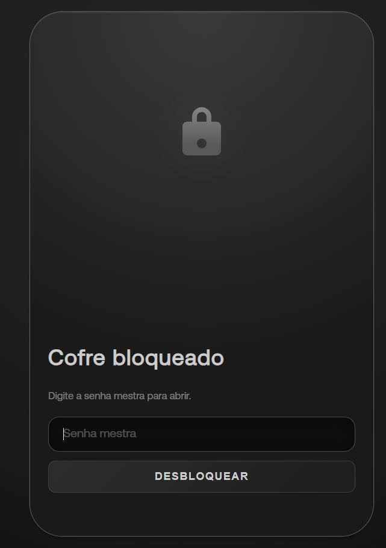
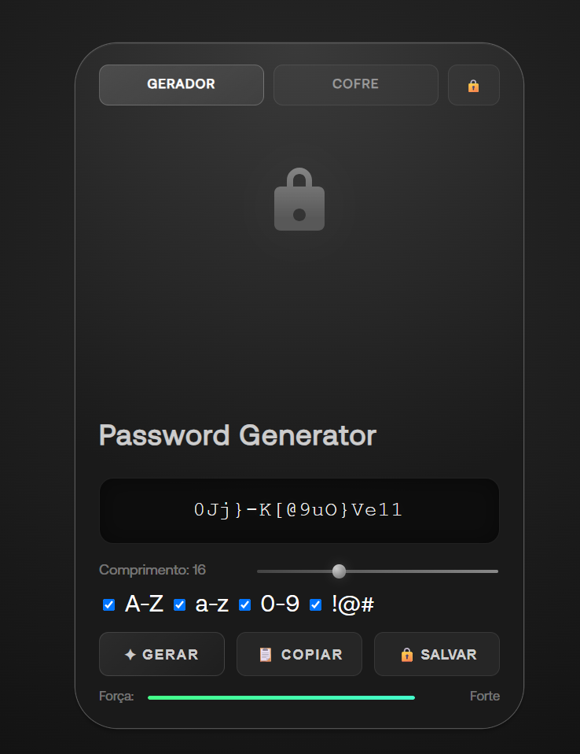
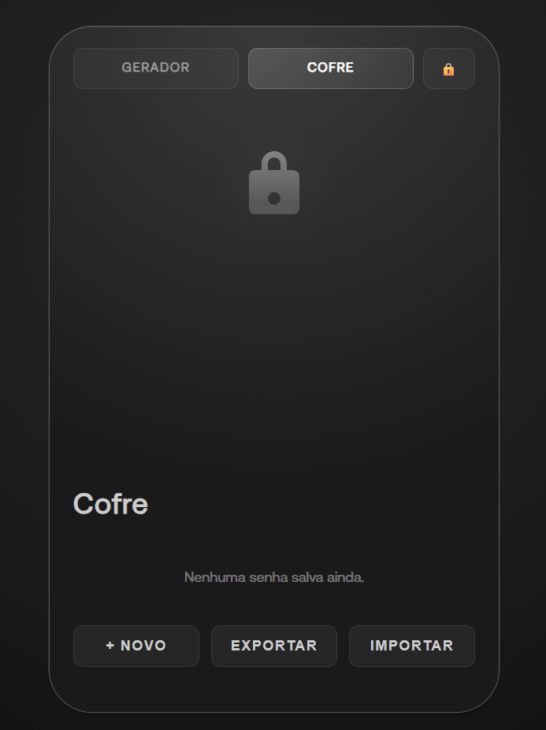

# 🔐 Luminous Vault

Gerador e **cofre de senhas local** para Windows, com criptografia forte e visual luminoso. Gere senhas fortes, guarde cada uma com título, site e usuário, e abra tudo com uma única senha mestra. Nada sai do seu computador.

<p align="center">
  
  
  
</p>

## ✨ Funcionalidades

- **Gerador** com tamanho de 8 a 32 caracteres, maiúsculas, minúsculas, números e símbolos, e indicador de força
- **Cofre** para salvar, editar e apagar senhas (título, site/origem, usuário e senha)
- **Senha mestra**: o app só abre com ela
- **Bloqueio automático** após 5 minutos sem uso e botão para bloquear na hora
- **Área de transferência limpa** 20 segundos após copiar uma senha
- **Backup**: exporta e importa o cofre (o arquivo continua criptografado)
- **Funciona offline** e abre como um aplicativo normal do Windows

## 🛡️ Segurança

| Item | Como funciona |
|---|---|
| Senha mestra | Nunca é salva em lugar nenhum |
| Derivação da chave | PBKDF2-SHA256 com 600.000 iterações e salt aleatório |
| Criptografia | AES-256-GCM (esconde os dados e detecta alterações no arquivo) |
| Aleatoriedade | `crypto.getRandomValues` (gerador criptográfico), com sorteio sem viés |
| Armazenamento | Arquivo criptografado em `%APPDATA%\luminous-vault\cofre.json` |
| Janela do app | `contextIsolation`, `sandbox`, sem Node na interface e política CSP restrita |

> ⚠️ **Se você esquecer a senha mestra, não há como recuperar o cofre.** Faça backups com o botão **Exportar**.
>
> Este é um projeto de estudo e portfólio e **não passou por auditoria de segurança**. Para senhas críticas (banco, e-mail principal), prefira ferramentas auditadas como KeePassXC ou Bitwarden.

## 🧰 Tecnologias

HTML, CSS e JavaScript puro, Web Crypto API e Electron (com electron-builder para gerar o instalador).

## 🚀 Como usar

### Opção 1: instalar o aplicativo
1. Abra a aba **Releases** deste repositório.
2. Baixe o arquivo `Luminous Vault Setup 1.0.0.exe` e execute.
3. Se o Windows mostrar o aviso do SmartScreen, clique em **Mais informações > Executar assim mesmo** (o app não tem assinatura digital paga).
4. Pesquise **Luminous Vault** no menu Iniciar.

### Opção 2: rodar pelo código
Pré-requisito: [Node.js](https://nodejs.org) (versão LTS).

```bash
git clone https://github.com/PaNiiCz/gerador_de_senhas.git
cd gerador_de_senhas
npm install
npm start
```

### Gerar o instalador

```bash
npm run dist
```

O instalador será criado na pasta `dist/`.

## 📁 Estrutura

```
gerador_de_senhas/
├── index.html      # Interface (bloqueio, gerador e cofre)
├── css/style.css   # Estilos
├── js/
│   ├── vault.js    # Criptografia e armazenamento do cofre
│   ├── script.js   # Gerador de senhas
│   └── app.js      # Telas, bloqueio automático e backup
├── main.js         # Processo principal do Electron
├── preload.js      # Ponte segura entre o app e o arquivo do cofre
└── package.json
```

## 🗺️ Próximos passos

- [ ] Ícone próprio do aplicativo
- [ ] Busca dentro do cofre
- [ ] Argon2id no lugar do PBKDF2
- [ ] Alterar a senha mestra

## 📄 Licença

Distribuído sob a licença ISC.